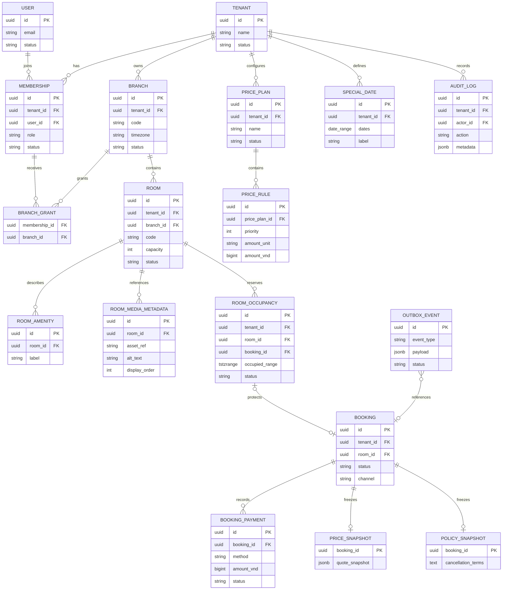

# ERD — Mô hình dữ liệu KaraokeNow

> Vai trò: SA · Phiên bản 1.0 · 22/11/2026  
> Sơ đồ khái niệm, không thay thế migration hiện hành. Entity dự kiến được đánh dấu `(planned)`; các tên cột chính xác cần đối chiếu migration trước khi triển khai.

## 1. Sơ đồ quan hệ

## 2. Domain notes

- `TENANT` là Merchant boundary trong schema dùng chung; mọi tenant-owned row giữ `tenant_id` và mọi service query phải scope theo tenant.
- `MEMBERSHIP` nối user với tenant và role; branch grant giới hạn các role branch-scoped.
- Room, amenity, media metadata và room blocks thuộc tenant/parent room; child lookup phải xác minh parent scope.
- `ROOM_OCCUPANCY` chứa maintenance block hiện có và booking/hold mục tiêu. GiST exclusion constraint áp dụng các status còn chiếm phòng. Không cho overlap cùng room.
- Pricing catalog/rules có migration; amount unit là per-hour/per-booking. Quote API đã có nhưng chưa có booking snapshot persistence.
- `BOOKING`, payment transaction, snapshot và event booking là mô hình target; chưa có schema/lifecycle booking trong repository tại thời điểm tài liệu.
- Payment manual pilot là transaction riêng, không lưu thông tin thẻ/tài khoản ngân hàng nhạy cảm.
- `ROOM_MEDIA_METADATA.asset_ref` là opaque ID, không phải URL; binary storage ngoài scope.

## 3. Ràng buộc dữ liệu bắt buộc

1. FK liên kết tenant/branch/room phải nhất quán tenant; không tin `tenant_id` do body client gửi.
2. Unique: `(tenant_id, branch_code)` và `(branch_id, room_code)` theo contract hiện hành.
3. `occupied_range` không rỗng; active occupancy cùng room không được overlap theo exclusion constraint.
4. Tiền lưu số nguyên VND; arithmetic/rounding tuân PD-019 và PD-011.
5. Snapshot là immutable sau khi booking transition xác nhận; sửa policy/rule sau đó không đổi quote cũ.
6. Audit lưu actor/action/target/time và metadata đã lọc; không lưu secrets hoặc raw payment credential.

## 4. Mở trước khi migration booking

- PD-024 approved: availability candidate range extends after booking by the configured cleanup buffer. Hold implementation must persist the same range.
- Booking/customer identity, idempotency key, hold expiry và unique reference.
- Quan hệ room price plan và hiệu lực special date; kiểm tra migrations thực tế khi mở rộng ERD.
- Retention, PII masking/deletion, audit retention và backup policy.

## 5. Nguồn kiểm chứng

`be/migrations/001*` tenant/branch/room; `002*` users/memberships/audit; `20261122090000*` room occupancy/blocks; `20261122180000*` amenities/media; `20261122200000*` pricing catalog; `20261122210000*` pricing units/duration. Booking/payment entities trong sơ đồ là proposed target, chưa được code.
