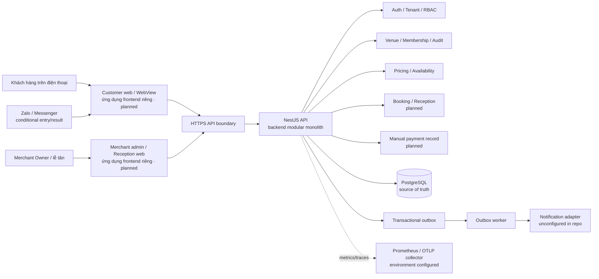

# HLD — Kiến trúc cấp cao KaraokeNow

> Vai trò biên soạn: Solution Architect (SA) · Phiên bản 1.0 · 22/11/2026  
> Phân biệt kiến trúc đã có trong repository với target MVP. Thành phần ngoài code được ghi “planned”.

## 1. Mục tiêu kiến trúc

- Giữ MVP dưới dạng NestJS modular monolith để giảm vận hành phân tán.
- Frontend là ứng dụng web riêng, có source/build/deployment riêng; backend NestJS chỉ cung cấp API và không render/host giao diện sản phẩm.
- Dùng PostgreSQL làm nguồn sự thật cho tenant, venue, pricing và occupancy.
- Cô lập mọi request theo tenant và branch ở backend.
- Booking correctness dựa vào transaction/constraint của PostgreSQL, không dựa riêng vào cache.
- Kênh Web, Zalo/Messenger WebView và Merchant UI gọi chung domain/API.
- Tích hợp thông báo qua transactional outbox; provider là adapter có thể thay thế.

## 2. Context và container

## 3. Thành phần và thực hiện

| Context/module | Responsibility | State |
|---|---|---|
| Platform/Auth | Login, JWT, refresh sessions, lockout, password change | Implemented baseline |
| Tenant/Roles | Validate active membership and branch grants | Implemented |
| Membership | Owner-managed staff membership | Implemented |
| Venue | Branch/room CRUD, status, amenity/media metadata | Implemented; no binary media |
| Availability | Maintenance room blocks and occupancy invariant | Block CRUD/invariant implemented; search/settings incomplete |
| Pricing | Price plans, special-date ranges, rule selectors, deterministic quote | Schema and quote API implemented; quote not snapshotted to booking |
| Booking | Holds, lifecycle, cancellations, check-in/out | Planned; core APIs absent |
| Payment | Pilot manual transaction records | Approved scope; implementation absent |
| Reception/customer web | Ứng dụng frontend tách biệt; gọi REST API qua HTTPS | Planned; chưa có frontend source trong repository backend |
| Audit | Transactional audit records and Owner read API | Implemented for current mutations |
| Outbox/notification | Commit-safe event dispatch and retry | Outbox/worker/port implemented; no live provider/booking producer |
| Operations | Health, metrics, trace context, structured redacted logs | Baseline implemented; backup/restore drill absent |

## 4. Deployment view

Current local environment: backend NestJS process, PostgreSQL via Docker Compose, migration runner. Repository hiện tại là backend-only; không có frontend app và backend không bundle UI. Frontend tương lai có artifact/build pipeline và deployment riêng (có thể ở repository riêng hoặc workspace riêng), gọi backend qua versioned HTTPS API/OpenAPI. Hai bên có thể dùng chung domain qua reverse proxy hoặc domain riêng; lựa chọn hosting/domain/CORS được quyết định khi thiết kế deployment. Production topology, ingress/WAF, managed database, object storage, secrets manager, replicas, queue/worker scaling and OTLP collector are not provisioned in repository. Do not represent them as deployed.

Target MVP deploys frontend web application(s) separately from backend API. Merchant UI and customer booking UI may be separate frontend applications or separately routed apps; either way they are independently built/released and consume API contracts. API and outbox worker may be separate processes from the same backend codebase. PostgreSQL is durable system of record. Redis is optional optimization for TTL/read paths and cannot establish booking correctness. WebView is a channel container for the customer frontend; it does not move UI rendering into NestJS.

## 5. Cross-cutting flows

- HTTP request: correlation ID → authentication → tenant membership → role/branch grant → DTO validation → domain service → scoped SQL → response/error envelope.
- Booking target: transaction locks/validates room availability, inserts occupancy and booking state; exclusion constraint is final race guard.
- Notification target: write domain mutation and outbox event in one transaction; worker claims/retries independently.
- Pricing: select one highest-priority matching rule using branch-local start date/time; quote endpoint exists, immutable booking snapshot remains to build.

## 6. Availability and failure handling

`room_occupancy` uses PostgreSQL range semantics and an exclusion constraint for active intervals. Maintenance block and booking occupancy share the invariant. Availability search is implemented and extends candidate intervals after booking end by the configured cleanup buffer under PD-024. The query does not reserve the room; the future hold transaction must write occupancy through that same extended end. On DB failure API readiness is unhealthy. External notification failure must not rollback committed business state.

## 7. Security boundaries

Public customer flow must never accept tenant authorization from a caller-controlled tenant header. Resolve public venue identity through published/public IDs and enforce publication state server-side. Merchant APIs require bearer session plus `X-Tenant-ID` and active membership. See `security-architecture.md`.

## 8. Quality attributes and open constraints

Zero overlapping active booking is correctness invariant. Latency, availability, RPO/RTO and scale numbers in Master Plan are targets only; no measured production evidence exists. Search behavior has automated PostgreSQL E2E evidence; production hosting/privacy retention/legal review remain open.

## 9. Key decisions

Modular monolith, PostgreSQL source of truth, shared-database tenancy, OpenAPI contract, outbox and independent booking/payment state machines are direction recorded in Master Plan/ADRs. Current technical implementation is reflected in Task Board; these documents do not themselves approve production deployment.
