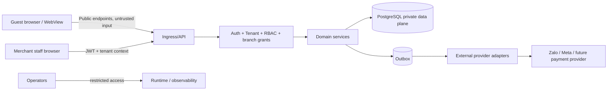

# Security Architecture — KaraokeNow

> Vai trò biên soạn: SA / Security · Phiên bản 1.0 · 22/11/2026  
> Đây là kiến trúc và trạng thái dựa trên repository; không phải chứng nhận tuân thủ hay pentest report.

## 1. Security objectives

- Chặn truy cập chéo tenant và branch.
- Bảo vệ tài khoản/session và hạn chế brute force/replay.
- Bảo vệ booking/occupancy khỏi race condition và sửa trái quyền.
- Giảm PII/secret lưu trữ hoặc xuất hiện trong log.
- Có audit, correlation và khả năng điều tra.
- Không bật payment/channel integration trước khi security controls và provider approvals sẵn sàng.

## 2. Trust boundaries

All browser input and provider callbacks are untrusted. Public endpoints must resolve only published venue data and must not use merchant bearer/tenant header as customer authorization.

Frontend Merchant và Customer là các ứng dụng độc lập ở trust boundary client; không nhúng secret backend/provider trong bundle, không kết nối DB trực tiếp. NestJS chỉ phục vụ API. CORS/origin allowlist, session storage, CSP và HTTPS deployment phải được cấu hình theo domain thực tế khi frontend được tạo.

## 3. Identity and access control

- Password login issues signed JWT; token lifetime 15 minutes and tied to server-side session.
- Refresh tokens rotate; reuse revokes token family. Logout/revocation and session inventory exist.
- Rate limit/lockout after repeated login failures; temporary password forces password change.
- Password reset design uses one-time code hash-only, 10-minute expiry, max five attempts, ZBS first; however ZBS account/template readiness is incomplete and live reset is blocked. Email deferred; if recipient cannot receive ZBS, direct to support without manual code delivery.
- Every Merchant API requires authenticated identity, `X-Tenant-ID`, active membership and role. Branch-scoped roles need explicit grant.
- Owner-only routes cover membership and audit read; mutations use conservative role matrix.
- MFA is deferred until after pilot (PD-018); this is a product-approved residual risk, not implemented control.

## 4. Tenant isolation and authorization

1. Derive actor identity from verified auth/session, never request body.
2. Validate tenant membership in guard per request.
3. Include tenant ID in every tenant-owned DB query and mutation.
4. Validate branch grant for each branch-scoped operation.
5. Scope child resources by parent room/branch and tenant; unauthorized cross-scope IDs should not disclose existence.
6. Test Tenant A/B, assigned/unassigned branches, nested child resources and mutation paths.

Current protections are tested for identity, membership and venue APIs; booking/public listing authorization remains to implement and test.

## 5. Data classification and protection

| Data | Classification | Control |
|---|---|---|
| Password | Secret | Hash at rest; never log or return |
| JWT/refresh token | Secret | Bearer transport; rotate/revoke; redact logs |
| Phone/email | Personal data | Minimize, restrict access, retention/deletion policy TBD |
| Booking details | Business-sensitive + potentially personal | Tenant scope, audit sensitive transitions |
| Pricing/configuration | Merchant confidential | Tenant scope and audit changes |
| Payment record | Financial metadata | Store amount/method/reference only; no card/bank credential in pilot |
| Media assetRef | Opaque reference | Constrained identifier, not arbitrary URL; file storage not implemented |
| Logs/traces | Operational | Allowlist fields; exclude body/query/auth/password; avoid PII attributes |

Encryption-at-rest key ownership, production secret manager, retention periods, deletion workflows and breach response are open deployment/legal tasks.

## 6. API and application protections

- DTO validation and standard error envelope; internal errors redact details.
- Correlation IDs and W3C trace context supported.
- Structured logger uses allowlist and redacts secret/PII-bearing fields.
- Tenant/role guards run before domain controller actions.
- Database constraints enforce referential and overlap invariants.
- Rate limiting exists for login; broader API abuse controls/rate budgets need deployment design.
- CORS, CSP, cookie/session configuration, CSRF (if cookies used), WAF, TLS termination, security headers and request-size limits must be finalized for web deployment.

## 7. Booking and payment threats

- Race attack: concurrent holds for same room/time → DB exclusion constraint plus transaction/idempotency; 100-concurrency test is a pilot gate and not yet implemented.
- Replay/duplicate request → idempotency key for hold/booking, not yet implemented.
- Late payment after expiry → no auto-confirm; payment is excluded from pilot.
- Fake/duplicate webhook → signature verification and inbox unique event ID after provider decision; not implemented.
- Unauthorized refund/cancel → explicit role/transition authorization, audit and staff review; workflow not implemented.
- Price tampering → server calculates quote; client-submitted amount is never authoritative; quote API exists, booking snapshot workflow pending.

## 8. External integrations and secrets

- Zalo OA cardinality approved: each Merchant belongs to one OA; OA may serve multiple Merchants. Account/App/template/permissions not ready.
- Zalo/Messenger channel callbacks require signature/identity verification, allowlisted events, replay defense and least-privilege scopes.
- Payment provider/MoR is post-pilot decision; no credentials or live endpoints in current system.
- Secrets must be injected via environment/secret manager; local `.env` ignored; sample values must be non-production.

## 9. Audit, monitoring and incident readiness

- Audit events are transactional for current membership/venue/block mutations; booking, pricing change and payment audit coverage must be added with those modules.
- Liveness/readiness and process-local Prometheus request metrics exist; W3C trace context and optional OTLP exporter exist.
- No collector configured/verified, no production alerting/SLO, no backup restore drill in repository.
- Before pilot: define severity/owners/escalation, ensure sensitive log review, rehearse DB recovery and verify access logging.

## 10. Threat model and release gates

| Threat | Required control / release evidence |
|---|---|
| Cross-tenant data exposure | Scoped queries + automated negative authorization tests |
| Credential theft/brute force | Password hashing, rotation/revocation, lockout, TLS, secrets control |
| Double booking | DB exclusion + concurrent integration test |
| PII leakage in logs | Redaction tests + sample log review |
| Forged channel/payment event | Signature validation, replay/idempotency tests before activation |
| Data loss | Backup/restore drill with measured RPO/RTO |
| Unauthorized policy/price change | Role checks, audit and immutable booking snapshots |

Do not activate production booking or external channels until applicable controls are implemented and evidenced. Availability search is implemented under approved PD-024; atomic hold/concurrency controls are still pending. Legal/privacy review and data retention policy remain required before live customer data.
