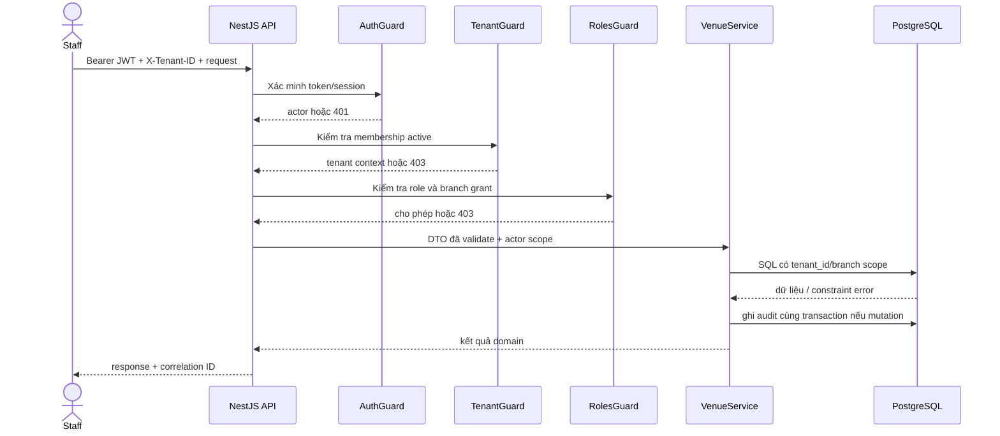
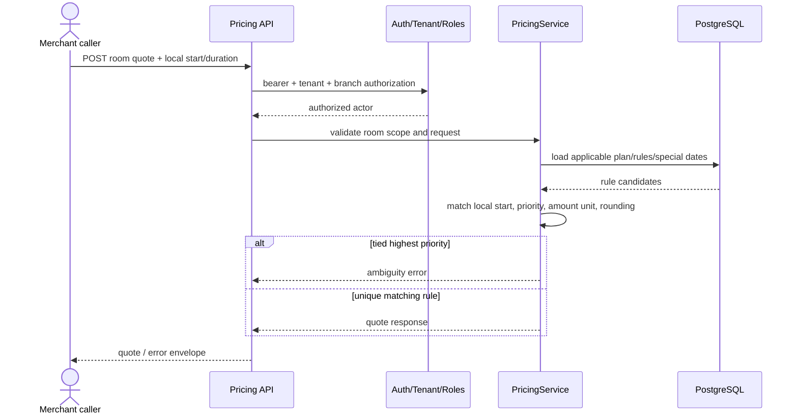
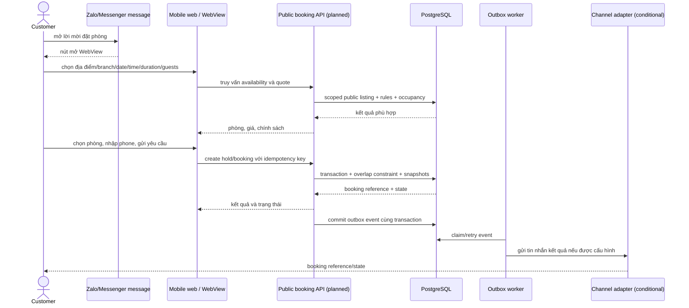
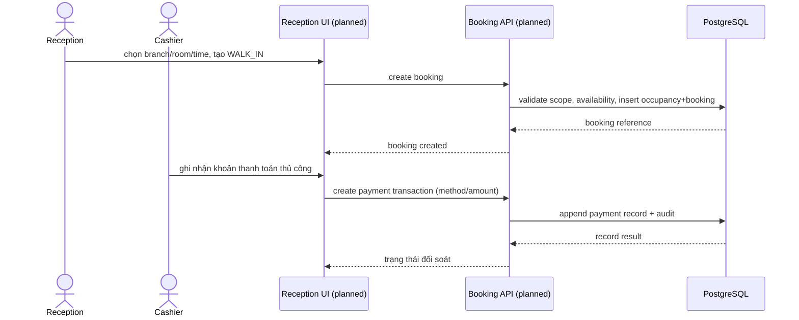
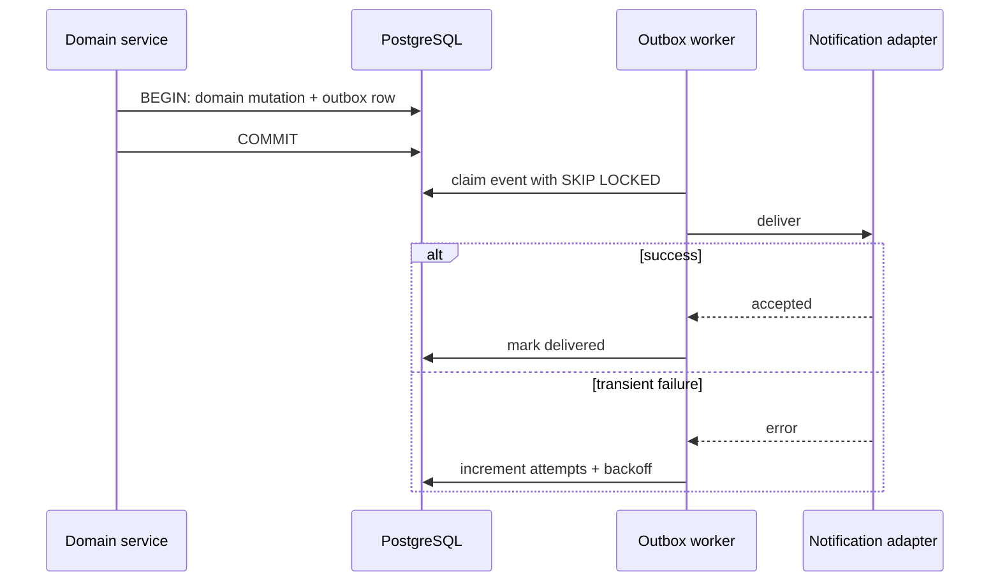

# Sequence Diagrams — KaraokeNow

> Vai trò: SA · Phiên bản 1.0 · 22/11/2026  
> Sơ đồ tách luồng đã có bằng chứng khỏi luồng mục tiêu chưa triển khai.

## 1. Merchant request hiện có: tenant + branch authorization

Trạng thái: pattern này được dùng ở auth, membership, venue, room blocks và audit APIs.

## 2. Quote giá hiện có

Quote API đã có. Persist snapshot vào booking là bước chưa triển khai.

## 3. Target customer booking từ Web/WebView

Luồng target; customer WebView, booking API, overlap lifecycle và channel adapter chưa được triển khai.

## 4. Target staff walk-in/manual payment

Chính sách walk-in/manual payment đã approved; UI/API chưa triển khai. Không có payment provider trong pilot.

## 5. Target outbox reliability

Outbox worker/retry nền tảng đã có; booking producer và live channel provider chưa có.
