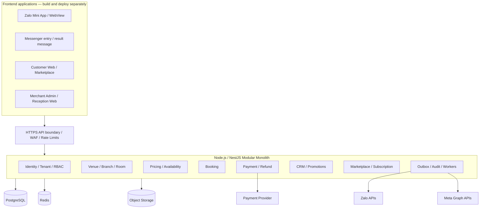
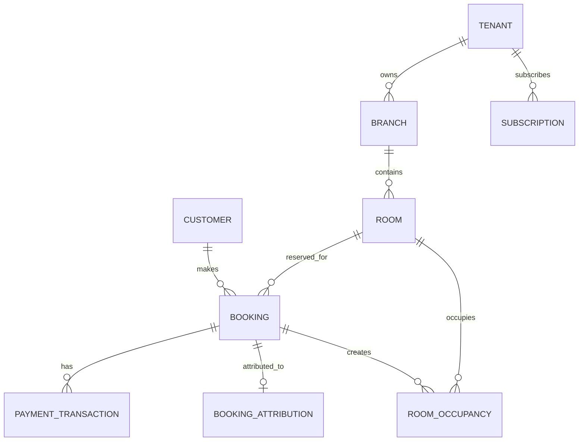

# KaraokeNow — Master Plan for Codex

> Version: 1.2 | Date: 2026-11-22 | Status: Mixed — product model, Hanoi pilot, MVP scope and selected business rules approved; implementation progress recorded below
> Product: Hybrid B2B SaaS + B2C Marketplace for karaoke room booking and management in Vietnam.
> Intended readers: Codex, Product Owner, BA, SA, Backend/Frontend developers, QA, DevOps, Marketing.

## 0. Instructions to Codex

Use this document as the initial project context. **Do not assume hypotheses, budget estimates, external API permissions or draft requirements are approved.** Before implementing, inspect the repository, identify existing code, dependencies, conventions and tests, and report gaps. Propose incremental changes, run actual tests, and distinguish implemented features from mocks or TODOs. Never invent working payment, Zalo or Meta integrations. Never use real payment credentials or production data in tests. Ask for approval before irreversible database changes, deployment, spending or connecting live providers.

Suggested sequence: (1) repository audit; (2) backlog refinement; (3) architecture decision records and API contracts; (4) database migrations and booking concurrency tests; (5) merchant administration; (6) web booking; (7) sandbox payment; (8) channel adapters; (9) pilot and marketplace.

## 1. Executive summary and vision

KaraokeNow is a **Hybrid SaaS + Marketplace** platform:
- B2B SaaS: karaoke merchants manage branches, rooms, pricing, availability, bookings, staff, customer relationships, reporting and marketing.
- B2C Marketplace: customers discover venues, compare rooms, view prices and availability, book, pay deposits and return.
- Customer channels: Zalo Mini App, web booking linked from Messenger, QR codes, and later a marketplace website.
- Merchant channels: web admin, reception dashboard and owner reporting.

**North-star metric:** completed bookings per month through the system, with no overlapping confirmed bookings and healthy merchant retention.

**Approved:** Hanoi is the pilot geography; the Hybrid SaaS + Marketplace model and MVP scope/pilot gates are recorded as PD-020–PD-022 in the Decision Log. MVP target of 12–16 weeks, pilot size of 5–10 merchants, and year-one stretch target of 100 paying merchants remain **planning assumptions, not approved targets**.

### Strategic sequencing

| Period | Focus | Target outcome |
|---|---|---|
| Months 1–3 | SaaS core and booking | Operational MVP |
| Months 4–6 | Pilot, Zalo, Messenger/web | Real merchants and customers |
| Months 7–9 | Marketplace and growth | Incremental bookings |
| Months 10–12 | Scale and monetization | Validated business economics |

**Do not build** full POS, inventory, IoT room controls or complex AI in MVP without evidence.

## 2. Business Plan

### Segments and value propositions

| Segment | Pain | Value |
|---|---|---|
| Small venues, 5–15 rooms | Manual scheduling | Simple centralized bookings |
| Medium venues, 16–40 rooms | Staff coordination, utilization | Calendar, CRM, reporting |
| Chains | Fragmented operations | Multi-branch management |
| Individuals and groups | Calling to check availability | Transparent booking and deposits |
| Corporate groups | Event coordination | Advance reservations and packages |

Merchant value: consolidate walk-in, phone, Zalo, Messenger and marketplace bookings in one availability source. Customer value: search, room details, prices, capacity, policies and online booking.

### Revenue streams and proposed pricing

| Revenue stream | Draft pricing |
|---|---|
| Starter SaaS | VND 299,000/merchant/month |
| Growth SaaS | VND 699,000/merchant/month |
| Pro SaaS | VND 1,490,000/merchant/month |
| Marketplace commission | 3–5% of eligible completed marketplace-originated bookings |
| Setup/integration | Project-based |
| Sponsored listings | Future only; transparently labeled |

Do not charge marketplace commission on merchant-owned bookings. The PO selected commission only for completed marketplace-attributed bookings, with a percentage configured per merchant and calculated on room revenue retained after discounts/refunds, excluding tax (PD-009/PD-013). During the pilot, record calculated amounts for reporting only; do not collect or settle commission and handle exceptions manually (PD-016).

### Competitive moat

Reliable real-time inventory -> better customer booking success -> more merchant revenue -> merchant retention -> more inventory. Avoid premature marketplace acquisition without supply density.

## 3. PRD — Product requirements

### Actors and access

- Platform Super Admin: platform configuration, merchant onboarding, fee management, dispute oversight.
- Merchant Owner: merchant account, branches, subscriptions, analytics.
- Branch Manager: assigned branch, rooms, prices, staff.
- Receptionist: booking operations, check-in/check-out.
- Cashier: payment reconciliation and authorized refunds.
- Customer: browse, book, pay, cancel, booking history.
- Marketing Operator: authorized campaigns and reporting.

Enforce authorization in APIs and database queries, not just UI.

### Modules and release priority

| ID | Module | Priority | Release | Trạng thái hiện tại |
|---|---|---|---|---|
| MOD-01 | Tenant / merchant identity and RBAC | P0 | MVP | **NỀN TẢNG ĐÃ LÀM** — auth, tenant membership, roles, branch grants, phiên qua F5 (PD-039), quản lý user Platform (PD-040), Super Admin hỗ trợ chỉ xem (PD-045); reset-code delivery còn phụ thuộc ZBS |
| MOD-02 | Branch and room management | P0 | MVP | **ĐÃ LÀM** — CRUD, trạng thái, tiện nghi; **upload ảnh phòng (≤ 10/phòng, FE nén trước), logo merchant, thư viện ảnh merchant và chi nhánh (≤ 10 mỗi nơi, PD-048), giấy tờ PDF trên Vercel Blob; ảnh phòng hiện cho khách (PD-049)** (PD-037: FILE-001 `DONE`, FE-015 `VERIFY`, production OPS-008 `VERIFY` chờ Owner thử trên giao diện); địa chỉ/SĐT/vị trí Google Maps (PD-042) và giờ mở cửa (PD-043) |
| MOD-03 | Pricing and availability | P0 | MVP | **ĐÃ LÀM** — bảng giá/quy tắc/ngày đặc biệt có ưu tiên tường minh, báo giá tất định có snapshot, chính sách thời lượng; khoá phòng bảo trì, buffer dọn phòng, tìm phòng trống; giờ mở cửa chi nhánh và giờ bắt đầu bước 15 phút cho khách (PD-043); hold quá hạn không còn chặn phòng (BKG-011) |
| MOD-04 | Booking engine | P0 | MVP | **ĐÃ LÀM (phạm vi pilot)** — hold staff/khách nguyên tử (GiST, đã thử 100 yêu cầu đồng thời), snapshot giá/cọc/điều khoản, xác nhận không cọc theo kênh hoặc khi đủ cọc, check-in/check-out, hủy/no-show do nhân viên ghi nhận, ghi phút overtime (PD-030), mã đặt phòng 6 ký tự (PD-038). miễn cọc theo trường hợp: giá trị nhỏ, giờ vắng, khách quen, nhân viên được phép miễn (PD-050, BKG-008) |
| MOD-05 | Deposit and payment | P0 | MVP | **ĐÃ LÀM (thủ công, pilot)** — ghi CASH cho booking, cọc CASH trên hold theo chính sách đã snapshot, xác nhận khi đủ cọc, phụ thu, đảo bút toán, xử lý cọc của hold hết hạn, phải thu/đã thu theo booking và báo cáo tiền mặt theo ngày (PAY-006, PAY-007, PD-033, PD-036). Online payment ngoài pilot |
| MOD-06 | Reception dashboard | P0 | MVP | **ĐÃ LÀM, chờ UAT** — lịch lễ tân hợp nhất hold/booking (REC-003), giữ chỗ, cọc, check-in/out, hủy/no-show, phải thu/đã thu và báo cáo tiền mặt (FE-014); kiểm thử trình duyệt tự động (Chrome headless) đạt; UAT có ký nhận chưa chạy |
| MOD-07 | Customer web booking | P0 | MVP | **ĐÃ LÀM, chờ UAT** — `/booking`: danh sách quán (logo, địa chỉ, nút gọi, chỉ đường Google Maps, giờ mở cửa), tìm phòng, báo giá, điều khoản có version, guest hold, tra cứu bằng SĐT + mã 6 ký tự; Platform Admin duyệt listing (FE-009). Hold khách vẫn cần nhân viên xác minh SĐT và xác nhận (UAT-PD-001–012) |
| MOD-08 | Zalo Mini App | P1 | Pilot | **CHƯA TÍCH HỢP** — quyền/SDK cần xác nhận; pilot channel approach phải được duyệt |
| MOD-09 | Messenger chatbot/deep-link integration | P1 | Pilot | **CHƯA TÍCH HỢP** — chờ xác minh quyền Meta và lựa chọn luồng |
| MOD-10 | CRM and loyalty | P1 | V1 | BACKLOG |
| MOD-11 | Marketplace discovery | P1 | V1 | BACKLOG — nền đã có: catalog công khai chỉ hiện merchant đã publish + được duyệt; tìm kiếm/lọc liên merchant và commission chưa làm |
| MOD-12 | Promotions and campaigns | P1 | V1 | BACKLOG |
| MOD-13 | SaaS subscription and billing | P1 | V1 | BACKLOG |
| MOD-14 | Analytics and reporting | P1 | V1 | **ĐÃ LÀM (bản đầu)** — báo cáo booking/doanh thu, công suất phòng + giờ cao điểm, kênh/chuyển đổi cho Owner/Branch Manager; tổng quan + bảng merchant cho Platform; xuất CSV (PD-044, RPT-001/002, FE-020) |
| MOD-15 | AI recommendations | P2 | V2 | BACKLOG |
| MOD-16 | POS/inventory integration | P2 | V2 | BACKLOG |

Customer UAT scope was narrowed on 2026-11-26 (`UAT-PD-001`–`012`): multiple merchants; guest phone required/email optional; public availability/quote; guest submission remains a hold until staff phone verification and confirmation; no-deposit or manually recorded deposit before confirmation; one merchant-configured public terms text snapshotted on acceptance; lookup by phone plus booking code; web result with staff call fallback; audited Platform Admin listing approval; explicit conflict instead of automatic room substitution; rate limits by IP/phone, idempotency and strong booking code without CAPTCHA/OTP. Online payment, customer accounts/OTP, automated messaging, public self-cancellation/refund, waiting lists and automatic room substitution are outside this UAT.

### Business requirements

- **BR-01 Rooms:** multiple branches per merchant; room capacity, amenities, media, operational status.
- **BR-02 Availability:** exclude overlapping confirmed bookings, valid holds, maintenance blocks; support variable durations.
- **BR-03 Pricing:** weekday/time-slot/holiday/room-type/duration rules with merchant-assigned explicit priority; reject tied/ambiguous matches, round final VND total to 1 VND, and snapshot quote and cancellation terms (PD-011 approved 2026-11-22).
- **BR-04 Omnichannel booking:** all sources use the same transactional booking engine.
- **BR-05 Deposits:** merchants may configure no-deposit, fixed or percentage deposit rules; default is no deposit. Owner/Branch Manager may configure no-deposit for online or other channels/cases; a valid hold and booking-rule checks remain required (PD-005 approved 2026-11-22).
- **BR-06 Cancellation/refund:** merchant supplies free-form terms per booking; show and snapshot exact terms. Authorized staff reviews and records outcomes; the system does not automatically decide refunds/no-shows (PD-006/PD-015 approved 2026-11-22).
- **BR-07 Attribution:** track booking origin, campaign and marketplace eligibility for commission.
- **BR-08 Privacy:** minimize data, separate service terms from marketing opt-in, implement retention and data-subject workflows.

### Functional requirements and acceptance criteria

| ID | Requirement | Acceptance criterion | Trạng thái |
|---|---|---|---|
| FR-001 | Create branch | Owner can create valid branch with timezone/status | **ĐÃ LÀM** — API và PostgreSQL E2E |
| FR-002 | Create room | Unique room code within branch | **ĐÃ LÀM CƠ BẢN** — API/CRUD; duplicate room-code assertion còn thiếu trong E2E |
| FR-003 | Pricing rules | Deterministic priority and correct quoted price | **ĐÃ LÀM** — báo giá có snapshot version; snapshot lưu vào hold (khi gắn thông tin khách/tạo public hold) và vào booking khi xác nhận |
| FR-004 | Search availability | Excludes blocked/occupied time intervals | **ĐÃ LÀM** — loại phòng inactive, bảo trì, occupancy chồng lấp, áp buffer sau giờ kết thúc; khách bị giới hạn theo giờ mở cửa và bước 15 phút; hold quá hạn không chặn (BKG-011). UAT chưa ký |
| FR-005 | Hold room | TTL-based hold, never conflicting active holds | **ĐÃ LÀM** — hold staff và khách nguyên tử, idempotent, TTL theo kênh; hết hạn khi có request chạm vào, khi ghi occupancy của phòng hoặc qua cron; test 100 yêu cầu đồng thời và benchmark |
| FR-006 | Confirm booking | Requires valid hold and payment/no-deposit conditions | **ĐÃ LÀM (pilot)** — cần hold còn hạn, SĐT đã xác minh và (kênh được phép không cọc hoặc cọc CASH đủ số đã snapshot); hoặc khớp trường hợp miễn cọc (PD-050) |
| FR-007 | Webhook processing | Duplicate webhook never double-charges/confirms | **NGOÀI PILOT / CHƯA LÀM** — provider/MoR chờ quyết định sau pilot |
| FR-008 | Cancel booking | Enforces rights and refund policy | **ĐÃ LÀM (BE)** — Owner/Branch Manager ghi một kết quả hủy/no-show kèm ghi chú và tiền hoàn CASH không vượt số đã thu (PD-027/PD-028); không tự quyết định hoàn tiền |
| FR-009 | Check-in | Only eligible booking can check in | **ĐÃ LÀM (BE)** — chỉ booking CONFIRMED, không giới hạn khung giờ (PD-026) |
| FR-010 | Check-out | Records actual usage end time | **ĐÃ LÀM (BE)** — ghi giờ kết thúc thực tế; về sớm rút ngắn occupancy về giờ thực tế + buffer, về muộn không kéo dài (PD-025); ghi phút trễ/overtime theo ân hạn merchant (PD-030) |
| FR-011 | Tenant isolation | Unauthorized cross-tenant access denied | **ĐÃ LÀM** — tenant và chi nhánh được kiểm ở mọi API, gồm booking, tiền và báo cáo (RPT-002); E2E nhiều vai trò, sai tenant → 403 |
| FR-012 | Audit | Sensitive state and pricing changes tracked | **ĐÃ LÀM** — audit trong cùng transaction cho mọi mutation (booking, tiền, giá, chính sách, Platform qua `platform_audit_logs`); không chứa PII/ghi chú tự do (AUD-002) |
| FR-013 | Marketplace listings | Only approved venues visible | **ĐÃ LÀM** — chỉ merchant đang hoạt động, `published` và `platform_approved` hiển thị công khai (PLT-001, PLT-003) |
| FR-014 | Attribution | Confirmation locks attribution fields | **MỘT PHẦN** — kênh (`channel`) lưu trên hold/booking và dùng trong báo cáo kênh (RPT-001); attribution campaign/marketplace và khoá khi xác nhận chưa làm (commission chưa thu trong pilot) |
| FR-015 | Notifications | Provider failure cannot roll back committed booking | **NỀN TẢNG ĐÃ LÀM** — outbox/adapter; chưa có booking event producer hay provider live |

### Nonfunctional targets (verify in performance tests)

- Availability: target 99.9% monthly after commercial launch.
- Standard API latency p95 < 500 ms, excluding external provider time.
- Availability search p95 < 1 s in agreed benchmark dataset.
- Booking correctness: zero overlapping confirmed bookings for the same room.
- Backup targets: RPO 15 minutes, RTO 4 hours (mục tiêu khi thương mại). Pilot hiện dùng PD-047: backup logic hằng đêm có mã hoá và diễn tập khôi phục tự động — RPO ≤ 24 h, RTO ≤ 1 h.
- Scale test scenario: 100 merchants / 3,000 rooms.
- TLS, RBAC, audit, secrets management, encryption of sensitive data, monitoring and tracing.
- Privacy and retention according to applicable Vietnamese law; obtain legal review.

### Booking state machine

`DRAFT -> HELD -> PENDING_PAYMENT -> CONFIRMED -> CHECKED_IN -> COMPLETED`

Alternative terminal paths: `HELD -> EXPIRED`; `PENDING_PAYMENT/CONFIRMED -> CANCELLED` subject to rules. Payment/refund state machines are independent. A late successful payment after hold expiration **must not** automatically confirm or seize an already-released room; record for reconciliation/refund or recheck availability via an explicit workflow.

### Core user journeys

1. Customer: browse venue -> choose room/date/time/duration -> see exact quote and policy -> hold -> pay a configured deposit when required -> confirmation -> reminder -> check-in -> completion -> feedback.
2. Reception: select branch -> calendar -> manually create/modify booking -> verify room occupancy -> check-in/out -> payment status.
3. Merchant onboarding: sign up -> verify merchant -> configure branch/rooms/prices -> preview public listing -> approve and publish.
4. Customer cancellation: verify ownership -> evaluate policy snapshot -> cancel/release room -> initiate refund if eligible -> notify.

### Open business decisions

**Còn mở:** grace period cho check-in (PD-026 không áp khung giờ check-in); overtime đã chốt PD-030 (chỉ ghi phút, không tính tiền), hóa đơn thuế, payment/MoR sau pilot, payout/đối soát/tranh chấp trước khi thu commission, giới hạn độ tuổi và xác minh giấy phép. **Đã chốt:** duration mặc định 30 phút (min 1h/max 8h, Merchant cấu hình); buffer mặc định 15 phút và có thể chỉnh; hold mặc định 15 phút theo kênh; no-deposit/fixed/percentage deposit và quyền bật no-deposit theo kênh; walk-in/cash ghi nhận riêng; khách guest booking cần số điện thoại, email tùy chọn; ưu tiên giá do Merchant đặt và từ chối tie; điều khoản hủy free-form được snapshot, nhân viên duyệt outcome, không tự động quyết định refund/no-show; commission chỉ áp dụng booking Marketplace hoàn tất trên doanh thu phòng giữ lại sau discount/refund, chưa thu/settle trong pilot. Từ PD-016 đến PD-047 đã chốt thêm: quyền Cashier, cọc, duyệt lại khi publish, đối soát tiền mặt, lưu ảnh/giấy tờ (Vercel Blob), mã đặt phòng 6 ký tự, giữ phiên qua F5, quản lý user Platform, giám sát job, địa chỉ/SĐT/vị trí Google Maps, giờ lẻ và giờ mở cửa, báo cáo, Super Admin hỗ trợ chỉ xem, Platform Admin kiêm Owner, backup production. Chi tiết và ngày duyệt nằm trong `docs/00-product/decision-log.md`.

## 4. Product backlog and delivery plan

2-week sprints; story points are **draft estimates only** and require team refinement.

| Epic | Story | SP | Sprint |
|---|---|---:|---|
| E01 | Tenant/merchant/branch setup | 13 | 1 |
| E01 | RBAC and branch authorization | 13 | 1–2 |
| E02 | Room CRUD, images, amenities | 13 | 2 |
| E03 | Price rules and special dates | 21 | 2–3 |
| E04 | Availability API | 21 | 3 |
| E04 | Holds, TTL and overlap protection | 21 | 3–4 |
| E04 | Booking lifecycle | 21 | 4 |
| E05 | Payment intent, webhook, idempotency | 21 | 5 |
| E05 | Cancellation, refunds, reconciliation | 13 | 5–6 |
| E06 | Reception calendar | 21 | 4–6 |
| E07 | Customer booking website | 21 | 5–6 |
| E08 | Zalo Mini App | 21 | 6–7 |
| E09 | Notification adapters | 13 | 7 |
| E10 | Audit, reports, dashboard | 13 | 7 |
| E11 | E2E/security/performance/UAT | 21 | 8 |

**Total preliminary:** 266 SP; validate velocity and dependencies. Messenger advanced integration and full marketplace come after MVP.

**Definition of Done:** reviewed code, relevant unit/integration tests, updated API contract, DB migration if needed, authorization, logging/audit, security checks, documentation and QA acceptance.

### Team and responsibilities

- PO/PM: vision, prioritization, roadmap, approvals.
- BA/UX: BRD/PRD, business rules, stories, UX flows.
- SA/Tech Lead: HLD, LLD oversight, ADR, API standards.
- Backend (2): domain services, DB, payment adapters, tests.
- Frontend/Mini App (2): merchant admin, web booking, Zalo UI.
- QA (1): test plan, automation, UAT.
- DevOps (0.5): CI/CD, monitoring, environments, backup.
- Sales/onboarding (1): merchant acquisition and pilot support.

## 5. HLD — Architecture

### Logical layers



### Technology stack

| Layer | Proposed stack |
|---|---|
| Zalo Mini App | React, TypeScript, ZMP SDK, ZaUI (verify current platform compatibility) |
| Web booking / merchant admin | Next.js, React, TypeScript |
| Backend | Node.js 24 LTS, TypeScript, NestJS |
| Primary DB | PostgreSQL |
| Cache and TTL support | Redis (`redis-byzantium-mirror` trên Vercel) chỉ dùng khi có số đo cần cache — **hiện chưa dùng**: TTL, hạn mức và khoá đều ở PostgreSQL; never sole correctness mechanism |
| Eventing | Transactional outbox + worker; Kafka only when justified |
| Storage | Vercel Blob (public: ảnh phòng, logo; private: giấy tờ PDF) qua `ObjectStorageService` — PD-037; đổi sang S3-compatible chỉ cần thay backend của service |
| Infra | Docker cho local/UAT (`be/compose.yaml`); production trên Vercel (FE `vn-karaoke-now`, BE `vn-karaoke-now-api` serverless, cron hằng ngày) + Prisma Postgres (PostgreSQL 17); Kubernetes only if justified |
| Observability | OpenTelemetry, Prometheus metrics, structured logs; `/v1/health/ready`, `/v1/health/jobs` cho uptime monitor (PD-041); Grafana chưa dựng |
| External adapters | Zalo, Meta, payment provider |

### Architecture decision records

- ADR-001 Node.js/TypeScript/NestJS Modular Monolith for MVP.
- ADR-002 PostgreSQL as transactional source of truth.
- ADR-003 Transactional outbox for committed domain events.
- ADR-004 Channel adapters isolate provider differences.
- ADR-005 Payment provider abstraction.
- ADR-006 Shared database multi-tenancy with strict tenant scoping.
- ADR-007 API-first using OpenAPI 3.1.
- ADR-008 Webhook inbox + idempotent processing.
- ADR-009 Independent booking/payment/refund state machines.

### Booking correctness example (illustrative SQL)

```sql
CREATE EXTENSION IF NOT EXISTS btree_gist;

CREATE TABLE room_occupancy (
  id UUID PRIMARY KEY,
  tenant_id UUID NOT NULL,
  room_id UUID NOT NULL,
  booking_id UUID NOT NULL,
  occupied_range TSTZRANGE NOT NULL,
  status VARCHAR(20) NOT NULL,
  CHECK (NOT isempty(occupied_range)),
  CHECK (status IN ('HELD','CONFIRMED','IN_USE','RELEASED'))
);

ALTER TABLE room_occupancy
ADD CONSTRAINT no_room_overlap
EXCLUDE USING gist (
  room_id WITH =,
  occupied_range WITH &&
)
WHERE (status IN ('HELD','CONFIRMED','IN_USE'));
```

Production LLD must add FKs, tenant consistency, booking/occupancy uniqueness, maintenance blocks, transaction isolation, idempotency, hold expiry transitions and recovery handling. The exclusion constraint protects occupancy conflicts; the wider workflow must also protect against concurrent maintenance blocks and late payments. Use `[start,end)` intervals and timezone-aware instants.

### Booking/payment sequence

1. `POST /booking-holds` validates quote and availability and inserts hold/occupancy atomically.
2. `POST /payments/intents` creates a provider request tied to hold and idempotency key.
3. Provider webhook signature is verified and deduplicated in inbox.
4. On successful payment, transaction checks hold validity, marks confirmed, writes payment state and outbox event.
5. Worker dispatches notifications; retry/backoff and dead-letter handling.
6. Late payment after expiry goes to exception/reconciliation, not automatic confirmation.

### Draft APIs

| Method | Endpoint | Purpose |
|---|---|---|
| GET | `/v1/marketplace/venues` | Venue search |
| GET | `/v1/venues/{id}/rooms` | Room catalog |
| GET | `/v1/availability` | Availability |
| POST | `/v1/booking-holds` | Hold room |
| POST | `/v1/bookings` | Create booking from hold |
| GET | `/v1/bookings/{id}` | Booking details |
| POST | `/v1/bookings/{id}/cancel` | Cancel |
| POST | `/v1/payments/intents` | Payment intent |
| POST | `/v1/webhooks/payments/{provider}` | Provider callback |
| GET | `/v1/merchant/bookings` | Merchant calendar |
| POST | `/v1/merchant/rooms` | Create room |
| GET | `/v1/merchant/reports/overview` | Merchant KPIs |

Use consistent error codes, `Idempotency-Key`, `X-Correlation-ID`, authentication, authorization, pagination and validation.

Bảng trên là bản nháp ban đầu. API thực tế (112 đường dẫn, 142 thao tác tại 2026-11-28) được sinh tự động ở `docs/02-architecture/openapi.json` và `docs/02-architecture/api-reference.md`; prefix `merchant/`, `platform/`, `public/`, `auth/`, `me/`.

### Environments

- DEV/SIT: local Docker (`be/compose.yaml`: Postgres `:5433`, backend `:3000`, frontend `:3100`), seed UAT, adapter thông báo giả.
- UAT/Staging: hiện dùng stack Docker local với seed UAT; **preview Vercel dùng chung DB production** — chưa có staging tách biệt.
- Production: Vercel + Prisma Postgres; push `main` = deploy (quy trình `docs/03-delivery/deploy-vercel.md`, migration chạy tay trước push); backup hằng đêm (PD-047); giám sát `/v1/health/jobs` (PD-041).

## 6. Logical data model

| Domain | Tables |
|---|---|
| Identity | `tenants`, `tenant_users`, `roles`, `user_roles` |
| Merchant | `venues`, `branches`, `rooms`, `room_amenities` |
| Pricing | `price_plans`, `price_rules`, `room_blocks` |
| Booking | `booking_holds`, `bookings`, `room_occupancy` |
| Payments | `payment_intents`, `payment_transactions`, `refunds`, `settlements` |
| Customers | `customers`, `customer_identities`, `customer_consents` |
| CRM | `loyalty_accounts`, `campaigns`, `coupons`, `coupon_redemptions` |
| Marketplace | `venue_listings`, `booking_attributions` |
| SaaS | `subscriptions`, `invoices` |
| Platform | `audit_logs`, `outbox_events`, `webhook_inbox` |



### `bookings` baseline fields

```sql
id UUID PRIMARY KEY,
tenant_id UUID NOT NULL,
branch_id UUID NOT NULL,
room_id UUID NOT NULL,
customer_id UUID,
booking_code VARCHAR(32) UNIQUE,
start_at TIMESTAMPTZ NOT NULL,
end_at TIMESTAMPTZ NOT NULL,
status VARCHAR(32) NOT NULL,
channel VARCHAR(32) NOT NULL,
total_amount NUMERIC(18,2) NOT NULL,
deposit_amount NUMERIC(18,2) NOT NULL,
currency CHAR(3) DEFAULT 'VND',
price_snapshot JSONB NOT NULL,
policy_snapshot JSONB NOT NULL,
created_at TIMESTAMPTZ NOT NULL,
updated_at TIMESTAMPTZ NOT NULL,
version BIGINT NOT NULL
```

### `booking_attributions` baseline fields

`booking_id, source_channel, source_type, campaign_id, referral_code, utm_source, utm_medium, utm_campaign, attributed_at, commission_eligible, commission_amount`

`source_type`: `MERCHANT_OWNED`, `MARKETPLACE`, `PARTNER_REFERRAL`, `WALK_IN`.

Avoid phone number as a unique customer identifier across channels. Identity linking requires verification and appropriate consent. Use tenant scoping, audit, retention and access controls.

## 7. Financial plan — 12 months

All figures are **planning assumptions**, not quotations or actual market statistics.

### Annual cost envelope (million VND)

| Category | Cost |
|---|---:|
| Product / BA / UX | 180 |
| Backend | 480 |
| Frontend / Mini App | 360 |
| QA / automation | 150 |
| DevOps / security | 90 |
| Cloud / DB / APIs / storage | 90 |
| Sales / merchant onboarding | 180 |
| Marketing | 240 |
| Legal / accounting / operations | 80 |
| **Subtotal** | **1,850** |
| Contingency 15% | 277.5 |
| **Total** | **2,127.5** |

Budget assumes lean staffing and partial outsourcing; fully dedicated hires may cost more. Does not represent accounting net loss.

### Monthly paying merchant targets

| Month | Paying merchants (month end) |
|---|---:|
| 1 | 0 |
| 2 | 0 |
| 3 | 0 |
| 4 | 2 |
| 5 | 5 |
| 6 | 10 |
| 7 | 18 |
| 8 | 28 |
| 9 | 40 |
| 10 | 55 |
| 11 | 75 |
| 12 | 100 |

Sum of month-end counts = 333 merchant-months (optimistic billing approximation). At ARPU VND 600,000/month, SaaS revenue = VND 199.8 million. Marketplace assumption: 3,000 completed bookings × VND 900,000 average GMV × 4% take rate = VND 108 million. Total illustrative year-one revenue = **VND 307.8 million**; budget less revenue = **VND 1,819.7 million**, *not* audited net loss or cash burn. Account for cancellations, taxes, payment costs and churn in refined model.

### Operating break-even hypothesis

Fixed operating cost VND 100 million/month; SaaS ARPU VND 600,000; SaaS variable cost 15%; net marketplace contribution VND 150,000 per merchant per month. Contribution per merchant = VND 660,000/month. Operating break-even approximately **152 active paying merchants**. Without marketplace contribution, approximately 197 merchants. This excludes recovering initial investment.

## 8. Marketing and GTM — 12 months

### Principles

- Supply-first: prioritize merchant inventory accuracy before broad customer acquisition.
- Start with a dense geographic cluster in Hanoi, then expand city-by-city.
- Measure *completed bookings*, not only booking creation or clicks.
- Separate B2B merchant acquisition from B2C customer acquisition and retention.

### Month-by-month GTM

| Month | Focus | Draft KPI |
|---|---|---|
| 1 | Interviews and discovery | 20 venues, 40 customers |
| 2 | Landing page and waitlist | 30 B2B leads |
| 3 | Pilot onboarding and in-venue QR | 5 pilot venues |
| 4 | First case study / conversion | 2 paying venues |
| 5 | Direct sales and merchant referrals | 5 paying venues |
| 6 | Public beta / paid channel tests | 10 paying venues |
| 7 | First local marketplace launch | 18 paying venues |
| 8 | Local SEO / KOC venue reviews | 28 paying venues |
| 9 | Group referrals and off-peak offers | 40 paying venues |
| 10 | Second geographic cluster | 55 paying venues |
| 11 | Corporate group packages | 75 paying venues |
| 12 | CAC/LTV and retention optimization | 100 paying venues |

### Channels

**B2B:** direct sales and demos; merchant referrals; partnerships with karaoke equipment/POS vendors; case studies about reduced scheduling errors and utilization.

**B2C:** Google Search for intent; TikTok/Reels for discovery; Facebook/Instagram for groups; Zalo OA for consent-based retention; in-venue QR; referrals; local SEO.

### Analytics funnel

`Ad/Search/QR -> Landing/Mini App -> Venue View -> Room View -> Availability Search -> Hold -> Payment -> Confirmed Booking -> Completed Booking -> Repeat Booking`

Instrument source/campaign attribution, cost per completed booking, repeat rate, merchant acquisition cost, conversion and retention. Respect provider messaging policies and customer consent.

### Marketing budget: VND 240 million/year

| Channel | Million VND |
|---|---:|
| B2B sales enablement | 60 |
| Paid social and search | 90 |
| Content and KOC | 36 |
| Referrals and vouchers | 36 |
| CRM, SEO and testing | 18 |

Release spend against supply quality and conversion gates rather than equal monthly spending.

## 9. QA strategy, UAT and go-live

Test categories: unit, integration, API contract, E2E, concurrency, security, performance, disaster recovery, UAT.

| Test | Scenario | Expected |
|---|---|---|
| TC-001 | 100 concurrent holds for one room/time | At most one active hold |
| TC-002 | Same payment webhook 5 times | Exactly one effective processing |
| TC-003 | Successful payment after hold expiry | No automatic confirmation |
| TC-004 | Cancel during refund | Consistent states and audit |
| TC-005 | Tenant A employee reads tenant B booking | Forbidden |
| TC-006 | Zalo unavailable | Booking persists, notification retries |
| TC-007 | Merchant changes pricing after booking | Original price snapshot retained |
| TC-008 | Reception and customer book same room | No overlap |
| TC-009 | Maintenance-blocked room | Not bookable |
| TC-010 | Worker crashes after DB commit | Outbox resumes after restart |

Go-live gates theo PD-022: dữ liệu/quyền Merchant được ký nhận; booking/availability correctness và concurrency pass; customer/reception flows qua UAT; hỗ trợ, giám sát và phục hồi sẵn sàng; Merchant pilot chấp nhận quy trình. Payment thủ công cần quy trình đối soát; online payment ngoài pilot. Quy mô năm Merchant là mục tiêu dự thảo chưa chốt. Quyền kênh ngoài phải được xác minh trước khi bật kênh, nhưng không chặn pilot web.

## 10. Risk register

| Risk | Severity | Mitigation |
|---|---|---|
| Merchants fail to update inventory | High | Simple reception workflow, onboarding, alerts |
| Overlapping bookings | Critical | DB exclusion constraints, transactions, stress tests |
| Payment inconsistency | Critical | Inbox/outbox, idempotency, reconciliation |
| Zalo/Meta policy changes | High | Channel adapters and web fallback |
| Low merchant willingness to pay | High | ROI-focused pilot, measured case studies |
| High customer acquisition cost | High | Local SEO, referrals, QR, dense supply |
| Insufficient marketplace inventory | High | Supply-first rollout |
| Personal data/privacy issues | High | Privacy by design, consent, legal review |
| Scope creep | High | MVP freeze and change control |
| Budget overrun | High | Stage-gate funding and variance reviews |

## 11. First 30 days

**Week 1 — Discovery:** interview merchants, reception staff and customers; produce discovery report, stakeholder map and business model canvas.

**Week 2 — Requirements/UX:** baseline BRD/PRD, business rules, story map, booking/reception wireframes and prototype.

**Week 3 — Architecture:** HLD, ERD, API contracts, ADRs, booking concurrency proof of concept and provider sandbox assessment.

**Week 4 — Sprint 0:** repositories, CI/CD, DEV/SIT, coding standards, migrations, telemetry, tests and sprint planning.

## 12. Deliverables and ownership

| Role | Deliverables |
|---|---|
| Sponsor/PO | Business plan, financial model, roadmap, KPI tree |
| BA | BRD, PRD, business rules, stories, acceptance criteria |
| SA | HLD, ERD, sequence diagrams, ADRs, security architecture |
| Backend | LLD, OpenAPI, DB migrations, event contracts |
| Frontend | UX/UI, design system, API integration |
| QA | Strategy, cases, data, UAT checklist |
| DevOps | Deployment, CI/CD, monitoring, backup, runbook |
| Marketing | GTM, ICP, campaigns, attribution, CAC/LTV |
| Sales/Ops | Onboarding SOP, pricing, support playbook |

## 13. Quyết định và phê duyệt

Các checkbox bên dưới phản ánh đúng trạng thái trong Decision Log tại ngày cập nhật; “đã chốt” là quyết định nghiệp vụ, không đồng nghĩa tính năng tương ứng đã được code hoặc tích hợp.

- [x] **Đã chốt (PD-020):** mô hình Hybrid SaaS + Marketplace.
- [x] **Đã chốt (PD-021):** địa bàn pilot Hà Nội.
- [x] **Đã chốt (PD-022):** phạm vi MVP và cổng pilot. MVP gồm tenant/RBAC, thiết lập chi nhánh/phòng, giá/availability, booking và vận hành lễ tân, web đặt phòng khách hàng, ghi nhận thanh toán thủ công. Pilot không có thanh toán online. Chỉ go-live sau khi ký nhận dữ liệu/quyền Merchant, qua kiểm thử availability/booking/concurrency, UAT khách hàng và lễ tân, sẵn sàng hỗ trợ/giám sát và Merchant pilot chấp nhận quy trình. Zalo/Messenger WebView là hạng mục có điều kiện, cần xác minh quyền nền tảng và không chặn pilot web.
- [x] **Quyết định kiến trúc frontend (ADR-012):** frontend là ứng dụng riêng, có source/build/release riêng và gọi backend qua HTTPS API/OpenAPI. Backend NestJS không render hoặc bundle UI. Repository hiện có `fe/` và `be/` tách biệt; cách tổ chức lâu dài thành repository riêng hay workspace chưa chốt.
- [ ] Ngân sách năm đầu khoảng 2,13 tỷ VND.
- [ ] Mục tiêu MVP 12–16 tuần và quy mô pilot 5–10 Merchant (vẫn là giả định kế hoạch, chưa được chốt).
- [x] **Đã chốt theo hướng kỹ thuật nền tảng:** Node.js 24 LTS + TypeScript + NestJS + PostgreSQL; trạng thái triển khai được ghi trong bảng 13.1. Phê duyệt kiến trúc tổng thể vẫn cần PO xác nhận.
- [x] **Đã chốt:** duration, buffer, hold TTL, deposit/no-deposit, xử lý walk-in/cash, guest booking, ưu tiên giá, điều khoản hủy và commission eligibility/base — xem PD-001 đến PD-015 trong Decision Log.
- [x] **Đã chốt cho pilot:** không thanh toán online; ghi nhận tiền thủ công (PD-007).
- [ ] Chọn payment provider/MoR sau pilot; hoàn tất payout, reconciliation và dispute trước khi thu commission.
- [ ] Xác minh quyền Zalo Mini App và Meta Messenger theo tài khoản/nền tảng thực tế.
- [ ] Xác nhận yêu cầu pháp lý về đối tác karaoke, bảo vệ người tiêu dùng và dữ liệu cá nhân với chuyên gia phù hợp.

### 13.1 Evidence-backed implementation progress

Backend in `be/`, frontend in `fe/`, shared documentation in `docs/`. This section records repository evidence as of **2026-11-28** (task board: 67 `DONE`, 37 `VERIFY`, 1 `READY`, 9 `BLOCKED`). `VERIFY` means code and automated tests are done and only browser QA/UAT sign-off remains. The checklist above distinguishes PO-approved product decisions from approvals still open; neither is proof that an implementation exists.

| Capability | Status | Repository evidence and remaining boundary |
|---|---|---|
| Node.js/NestJS/PostgreSQL foundation | Done | Modular monolith, 31 migrations (each with `down`), OpenAPI generated with drift check, Docker dev stack, CI for BE and FE |
| Authentication, membership and RBAC | Done (pilot) | Password login/change, JWT + rotating refresh in an HttpOnly cookie (PD-039), lockout, tenant membership, branch grants, merchant picker; Platform user management (PD-040), Super Admin read-only support sessions with masking (PD-045), Platform Admin may also be an Owner (PD-046). Reset code via ZBS blocked (IAM-004); MFA after pilot |
| Branch and room operations | Done | CRUD/status, amenities, room photos/logo/PDF documents on Vercel Blob (PD-037), merchant and branch galleries ≤ 10 each (PD-048), branch address/phone/Google Maps location (PD-042), opening hours (PD-043) |
| Pricing and availability | Done | Plans/rules/special dates with explicit priority, deterministic quote snapshots, duration policy, maintenance blocks, cleanup buffer, availability search; customer start times in 15-minute steps within opening hours |
| Booking lifecycle | Done (pilot) | GiST occupancy invariant with per-room advisory lock; staff/public holds with price, deposit and terms snapshots; overdue holds released on write (BKG-011); confirmation (no-deposit or deposit-covered); check-in/out, staff-reviewed cancellation/no-show, overtime minutes (PD-030); 6-character booking code (PD-038); case-level deposit exemptions and staff waivers (PD-050) |
| Payment (manual pilot) | Done | CASH deposits on holds, CASH on bookings, surcharges, full reversals, refunds on outcome, expired-hold deposit resolution, due/paid per booking, daily cash report (PD-033/036). Online payment out of pilot (PAY-002–004 blocked) |
| Reports | Done (first release) | Merchant: bookings/revenue, occupancy + peak hours, channels/conversion; Platform: growth/activity, per-merchant table; CSV; data-level scope reviewed (PD-044, RPT-001/002) |
| Platform administration | Done | Listing approve/revoke, manual merchant onboarding, suspension/reactivation, merchant documents, user management, Super Admin support sessions |
| Transactional outbox / notifications | Foundation done | Outbox with claim/retry/dead/recovery; notification port with recording adapter. No live provider and no booking event producer yet |
| Operations | Done (pilot) | Vercel production since 2026-11-28, pool/timeouts, client IP behind rewrite, `/v1/health/jobs` for uptime monitoring (OPS-009 registration by PO pending), nightly encrypted backup + restore drill workflow (PD-047; OPS-010 waiting for GitHub secrets) |
| Performance | Local done (QA-002) | `npm run bench:booking`: all p95 targets met (re-run after BKG-011: search 24.5 ms, contention 175 ms); staging run pending |
| Frontend | Code done, in `VERIFY` | Customer `/booking`, merchant workspace, `/platform`; types generated from OpenAPI with CI drift check (FE-011). Browser e2e (Chrome headless) 248/248 at FE-021 |
| UAT | Ready, not executed | `docs/04-quality/uat-checklist.md` groups A–Q (88 cases), two-merchant seed with all roles and a Super Admin; execution and sign-off pending |
| Not started / blocked | — | Zalo Mini App, Messenger (platform approvals), online payment/MoR, marketplace discovery, CRM/loyalty, promotions, SaaS billing, attribution beyond channel, staging environment separate from production |

Latest verification (2026-11-28, Node 26): backend `npm run verify` 73/73 unit tests + OpenAPI/Markdown drift, `npm run test:e2e` 57/57 PostgreSQL Docker E2E (including OpenAPI contract checks of real responses); local restore drill `counts_match=yes`; frontend unit 71/71, `types:check`, `next build`, browser e2e 248/248. Production smoke after each deploy is recorded in `docs/03-delivery/work-log.md`.

## 14. Codex execution prompts

### Prompt A — Repository audit and implementation roadmap

```text
Read KaraokeNow_Codex_Master_Plan.md completely. Inspect the current repository and identify what already exists. Do not assume any component is implemented. Produce: (1) repo inventory, (2) gap analysis against P0 MVP, (3) proposed folder structure, (4) ADR questions, (5) dependency and risk register, (6) first two sprints with verifiable acceptance tests. Do not modify files yet. Separate approved facts from assumptions and open decisions.
```

### Prompt B — Backend foundation

```text
Based on KaraokeNow_Codex_Master_Plan.md and the repository audit, implement the smallest production-quality Node.js/TypeScript/NestJS foundation for multi-tenant merchants, branches and rooms, with node-pg-migrate migrations, validation, tenant authorization, OpenAPI, unit/integration tests and Docker development setup. First present a change plan. Never claim tests passed unless actually run. Do not connect live payment or messaging APIs.
```

### Prompt C — Booking engine proof of correctness

```text
Design and implement a transactional booking hold engine in PostgreSQL using exclusion constraints for non-overlapping room occupancy. Include expiration processing, idempotency, explicit state transitions, maintenance blocks, concurrent reception/customer bookings, and tests with at least 100 simultaneous requests for the same room and time. Explain isolation guarantees and failure recovery. Use synthetic data only.
```

### Prompt D — UX and frontend

```text
Create an accessible, responsive merchant reception dashboard and customer booking web UI based on the PRD. Start with wireframes and API contracts, then implement with mock data clearly labeled as mock until backend endpoints exist. Include loading/error/empty states, booking cancellation policy display, and mobile-first customer flow. Do not claim Zalo or Messenger native integration until verified.
```

### Prompt E — QA and launch readiness

```text
Generate traceability matrix FR -> API -> automated tests -> UAT cases. Run existing tests and report real outcomes. Create a release readiness checklist, payment reconciliation test plan, security checklist, backup/recovery drill and merchant pilot SOP. Clearly label unverified external integrations and unmet release gates.
```

## 15. Suggested repository documentation layout

```text
docs/
  00-product/
    business-plan.md
    product-roadmap.md
    decision-log.md
  01-requirements/
    prd.md
    business-rules.md
    user-stories.md
    acceptance-criteria.md
  02-architecture/
    hld.md
    adr/
    erd.md
    api-contracts.md
    security.md
  03-delivery/
    sprint-plan.md
    risk-register.md
    release-checklist.md
  04-quality/
    test-strategy.md
    uat-cases.md
  05-gtm/
    marketing-plan.md
    financial-model.md
    merchant-onboarding.md
```

## 16. Final project guidance

The critical MVP path is **accurate room availability -> atomic hold -> trustworthy payment -> booking confirmation -> reception operation**. Validate merchant willingness to pay before scaling marketplace demand. Every feature should be linked to a measurable user/business outcome and an executable acceptance test.
