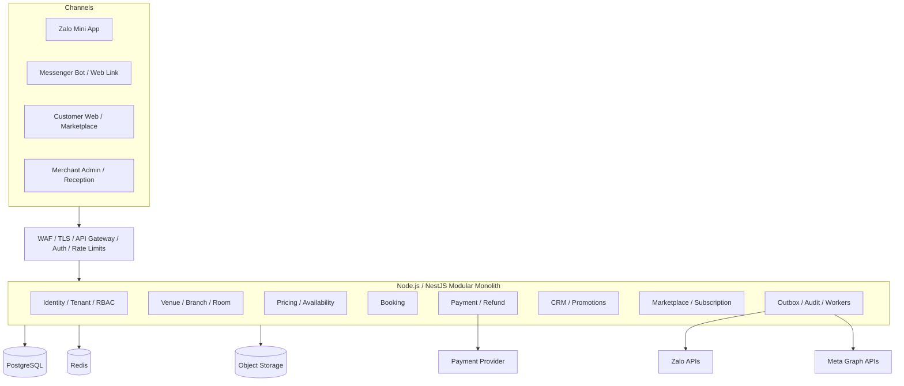
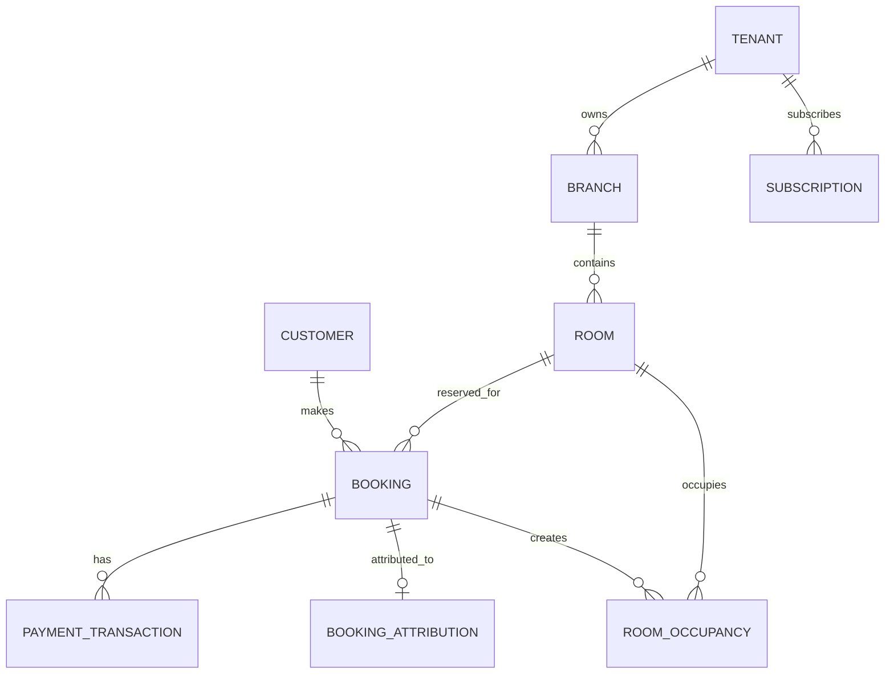

# KaraokeNow — Master Plan for Codex

> Version: 1.0 | Date: 2026-11-22 | Status: Planning baseline, not approved requirements
> Product: Hybrid B2B SaaS + B2C Marketplace for karaoke room booking and management in Vietnam.
> Intended readers: Codex, Product Owner, BA, SA, Backend/Frontend developers, QA, DevOps, Marketing.

## 0. Instructions to Codex

Use this document as the initial project context. **Do not assume hypotheses, budget estimates, external API permissions or draft requirements are approved.** Before implementing, inspect the repository, identify existing code, dependencies, conventions and tests, and report gaps. Propose incremental changes, run actual tests, and distinguish implemented features from mocks or TODOs. Never invent working payment, Zalo or Meta integrations. Never use real payment credentials or production data in tests. Ask for approval before irreversible database changes, deployment, spending or connecting live providers.

Suggested sequence: (1) repository audit; (2) backlog refinement; (3) architecture decision records and API contracts; (4) database migrations and booking concurrency tests; (5) merchant administration; (6) web booking; (7) sandbox payment; (8) channel adapters; (9) pilot and marketplace.

## 1. Executive summary and vision

KaraokeNow is a **Hybrid SaaS + Marketplace** platform:
- B2B SaaS: karaoke merchants manage branches, rooms, pricing, availability, bookings, staff, customer relationships, reporting and marketing.
- B2C Marketplace: customers discover venues, compare rooms, view prices and availability, book, pay deposits and return.
- Customer channels: Zalo Mini App, web booking linked from Messenger, QR codes, and later a marketplace website.
- Merchant channels: web admin, reception dashboard and owner reporting.

**North-star metric:** completed bookings per month through the system, with no overlapping confirmed bookings and healthy merchant retention.

Launch market hypothesis: Hanoi. MVP target: 12–16 weeks. Pilot: 5–10 merchants. Year-one stretch target: 100 paying merchants. All targets require validation.

### Strategic sequencing

| Period | Focus | Target outcome |
|---|---|---|
| Months 1–3 | SaaS core and booking | Operational MVP |
| Months 4–6 | Pilot, Zalo, Messenger/web | Real merchants and customers |
| Months 7–9 | Marketplace and growth | Incremental bookings |
| Months 10–12 | Scale and monetization | Validated business economics |

**Do not build** full POS, inventory, IoT room controls or complex AI in MVP without evidence.

## 2. Business Plan

### Segments and value propositions

| Segment | Pain | Value |
|---|---|---|
| Small venues, 5–15 rooms | Manual scheduling | Simple centralized bookings |
| Medium venues, 16–40 rooms | Staff coordination, utilization | Calendar, CRM, reporting |
| Chains | Fragmented operations | Multi-branch management |
| Individuals and groups | Calling to check availability | Transparent booking and deposits |
| Corporate groups | Event coordination | Advance reservations and packages |

Merchant value: consolidate walk-in, phone, Zalo, Messenger and marketplace bookings in one availability source. Customer value: search, room details, prices, capacity, policies and online booking.

### Revenue streams and proposed pricing

| Revenue stream | Draft pricing |
|---|---|
| Starter SaaS | VND 299,000/merchant/month |
| Growth SaaS | VND 699,000/merchant/month |
| Pro SaaS | VND 1,490,000/merchant/month |
| Marketplace commission | 3–5% of eligible completed marketplace-originated bookings |
| Setup/integration | Project-based |
| Sponsored listings | Future only; transparently labeled |

Do not charge marketplace commission on merchant-owned bookings initially. Define immutable attribution at booking confirmation, refund adjustments, payout/reconciliation and disputes before enabling fees.

### Competitive moat

Reliable real-time inventory -> better customer booking success -> more merchant revenue -> merchant retention -> more inventory. Avoid premature marketplace acquisition without supply density.

## 3. PRD — Product requirements

### Actors and access

- Platform Super Admin: platform configuration, merchant onboarding, fee management, dispute oversight.
- Merchant Owner: merchant account, branches, subscriptions, analytics.
- Branch Manager: assigned branch, rooms, prices, staff.
- Receptionist: booking operations, check-in/check-out.
- Cashier: payment reconciliation and authorized refunds.
- Customer: browse, book, pay, cancel, booking history.
- Marketing Operator: authorized campaigns and reporting.

Enforce authorization in APIs and database queries, not just UI.

### Modules and release priority

| ID | Module | Priority | Release |
|---|---|---|---|
| MOD-01 | Tenant / merchant identity and RBAC | P0 | MVP |
| MOD-02 | Branch and room management | P0 | MVP |
| MOD-03 | Pricing and availability | P0 | MVP |
| MOD-04 | Booking engine | P0 | MVP |
| MOD-05 | Deposit and payment | P0 | MVP |
| MOD-06 | Reception dashboard | P0 | MVP |
| MOD-07 | Customer web booking | P0 | MVP |
| MOD-08 | Zalo Mini App | P1 | Pilot |
| MOD-09 | Messenger chatbot/deep-link integration | P1 | Pilot |
| MOD-10 | CRM and loyalty | P1 | V1 |
| MOD-11 | Marketplace discovery | P1 | V1 |
| MOD-12 | Promotions and campaigns | P1 | V1 |
| MOD-13 | SaaS subscription and billing | P1 | V1 |
| MOD-14 | Analytics and reporting | P1 | V1 |
| MOD-15 | AI recommendations | P2 | V2 |
| MOD-16 | POS/inventory integration | P2 | V2 |

### Business requirements

- **BR-01 Rooms:** multiple branches per merchant; room capacity, amenities, media, operational status.
- **BR-02 Availability:** exclude overlapping confirmed bookings, valid holds, maintenance blocks; support variable durations.
- **BR-03 Pricing:** weekday/time-slot/holiday/room-type/duration rules with explicit precedence; snapshot final quote and cancellation policy.
- **BR-04 Omnichannel booking:** all sources use the same transactional booking engine.
- **BR-05 Deposits:** configurable fixed or percentage deposits; payment success required for confirmation unless merchant permits no-deposit bookings.
- **BR-06 Cancellation/refund:** versioned policies, authorization, customer disclosure, audit trail.
- **BR-07 Attribution:** track booking origin, campaign and marketplace eligibility for commission.
- **BR-08 Privacy:** minimize data, separate service terms from marketing opt-in, implement retention and data-subject workflows.

### Functional requirements and acceptance criteria

| ID | Requirement | Acceptance criterion |
|---|---|---|
| FR-001 | Create branch | Owner can create valid branch with timezone/status |
| FR-002 | Create room | Unique room code within branch |
| FR-003 | Pricing rules | Deterministic priority and correct quoted price |
| FR-004 | Search availability | Excludes blocked/occupied time intervals |
| FR-005 | Hold room | TTL-based hold, never conflicting active holds |
| FR-006 | Confirm booking | Requires valid hold and payment/no-deposit conditions |
| FR-007 | Webhook processing | Duplicate webhook never double-charges/confirms |
| FR-008 | Cancel booking | Enforces rights and refund policy |
| FR-009 | Check-in | Only eligible booking can check in |
| FR-010 | Check-out | Records actual usage end time |
| FR-011 | Tenant isolation | Unauthorized cross-tenant access denied |
| FR-012 | Audit | Sensitive state and pricing changes tracked |
| FR-013 | Marketplace listings | Only approved venues visible |
| FR-014 | Attribution | Confirmation locks attribution fields |
| FR-015 | Notifications | Provider failure cannot roll back committed booking |

### Nonfunctional targets (verify in performance tests)

- Availability: target 99.9% monthly after commercial launch.
- Standard API latency p95 < 500 ms, excluding external provider time.
- Availability search p95 < 1 s in agreed benchmark dataset.
- Booking correctness: zero overlapping confirmed bookings for the same room.
- Backup targets: RPO 15 minutes, RTO 4 hours.
- Scale test scenario: 100 merchants / 3,000 rooms.
- TLS, RBAC, audit, secrets management, encryption of sensitive data, monitoring and tracing.
- Privacy and retention according to applicable Vietnamese law; obtain legal review.

### Booking state machine

`DRAFT -> HELD -> PENDING_PAYMENT -> CONFIRMED -> CHECKED_IN -> COMPLETED`

Alternative terminal paths: `HELD -> EXPIRED`; `PENDING_PAYMENT/CONFIRMED -> CANCELLED` subject to rules. Payment/refund state machines are independent. A late successful payment after hold expiration **must not** automatically confirm or seize an already-released room; record for reconciliation/refund or recheck availability via an explicit workflow.

### Core user journeys

1. Customer: browse venue -> choose room/date/time/duration -> see exact quote and policy -> hold -> deposit -> confirmation -> reminder -> check-in -> completion -> feedback.
2. Reception: select branch -> calendar -> manually create/modify booking -> verify room occupancy -> check-in/out -> payment status.
3. Merchant onboarding: sign up -> verify merchant -> configure branch/rooms/prices -> preview public listing -> approve and publish.
4. Customer cancellation: verify ownership -> evaluate policy snapshot -> cancel/release room -> initiate refund if eligible -> notify.

### Open business decisions

Booking duration increments, buffer between sessions, overtime, grace period, walk-ins, no-show handling, partial refunds, tax invoicing, cash deposits, payment merchant-of-record, commission calculation, customer account identity matching, age restrictions and business license verification all require BA/PO decisions.

## 4. Product backlog and delivery plan

2-week sprints; story points are **draft estimates only** and require team refinement.

| Epic | Story | SP | Sprint |
|---|---|---:|---|
| E01 | Tenant/merchant/branch setup | 13 | 1 |
| E01 | RBAC and branch authorization | 13 | 1–2 |
| E02 | Room CRUD, images, amenities | 13 | 2 |
| E03 | Price rules and special dates | 21 | 2–3 |
| E04 | Availability API | 21 | 3 |
| E04 | Holds, TTL and overlap protection | 21 | 3–4 |
| E04 | Booking lifecycle | 21 | 4 |
| E05 | Payment intent, webhook, idempotency | 21 | 5 |
| E05 | Cancellation, refunds, reconciliation | 13 | 5–6 |
| E06 | Reception calendar | 21 | 4–6 |
| E07 | Customer booking website | 21 | 5–6 |
| E08 | Zalo Mini App | 21 | 6–7 |
| E09 | Notification adapters | 13 | 7 |
| E10 | Audit, reports, dashboard | 13 | 7 |
| E11 | E2E/security/performance/UAT | 21 | 8 |

**Total preliminary:** 266 SP; validate velocity and dependencies. Messenger advanced integration and full marketplace come after MVP.

**Definition of Done:** reviewed code, relevant unit/integration tests, updated API contract, DB migration if needed, authorization, logging/audit, security checks, documentation and QA acceptance.

### Team and responsibilities

- PO/PM: vision, prioritization, roadmap, approvals.
- BA/UX: BRD/PRD, business rules, stories, UX flows.
- SA/Tech Lead: HLD, LLD oversight, ADR, API standards.
- Backend (2): domain services, DB, payment adapters, tests.
- Frontend/Mini App (2): merchant admin, web booking, Zalo UI.
- QA (1): test plan, automation, UAT.
- DevOps (0.5): CI/CD, monitoring, environments, backup.
- Sales/onboarding (1): merchant acquisition and pilot support.

## 5. HLD — Architecture

### Logical layers



### Technology stack

| Layer | Proposed stack |
|---|---|
| Zalo Mini App | React, TypeScript, ZMP SDK, ZaUI (verify current platform compatibility) |
| Web booking / merchant admin | Next.js, React, TypeScript |
| Backend | Node.js 24 LTS, TypeScript, NestJS |
| Primary DB | PostgreSQL |
| Cache and TTL support | Redis; never sole correctness mechanism |
| Eventing | Transactional outbox + worker; Kafka only when justified |
| Storage | S3-compatible object storage |
| Infra | Docker first; managed services; Kubernetes only if justified |
| Observability | OpenTelemetry, Prometheus, Grafana, structured logs |
| External adapters | Zalo, Meta, payment provider |

### Architecture decision records

- ADR-001 Node.js/TypeScript/NestJS Modular Monolith for MVP.
- ADR-002 PostgreSQL as transactional source of truth.
- ADR-003 Transactional outbox for committed domain events.
- ADR-004 Channel adapters isolate provider differences.
- ADR-005 Payment provider abstraction.
- ADR-006 Shared database multi-tenancy with strict tenant scoping.
- ADR-007 API-first using OpenAPI 3.1.
- ADR-008 Webhook inbox + idempotent processing.
- ADR-009 Independent booking/payment/refund state machines.

### Booking correctness example (illustrative SQL)

```sql
CREATE EXTENSION IF NOT EXISTS btree_gist;

CREATE TABLE room_occupancy (
  id UUID PRIMARY KEY,
  tenant_id UUID NOT NULL,
  room_id UUID NOT NULL,
  booking_id UUID NOT NULL,
  occupied_range TSTZRANGE NOT NULL,
  status VARCHAR(20) NOT NULL,
  CHECK (NOT isempty(occupied_range)),
  CHECK (status IN ('HELD','CONFIRMED','IN_USE','RELEASED'))
);

ALTER TABLE room_occupancy
ADD CONSTRAINT no_room_overlap
EXCLUDE USING gist (
  room_id WITH =,
  occupied_range WITH &&
)
WHERE (status IN ('HELD','CONFIRMED','IN_USE'));
```

Production LLD must add FKs, tenant consistency, booking/occupancy uniqueness, maintenance blocks, transaction isolation, idempotency, hold expiry transitions and recovery handling. The exclusion constraint protects occupancy conflicts; the wider workflow must also protect against concurrent maintenance blocks and late payments. Use `[start,end)` intervals and timezone-aware instants.

### Booking/payment sequence

1. `POST /booking-holds` validates quote and availability and inserts hold/occupancy atomically.
2. `POST /payments/intents` creates a provider request tied to hold and idempotency key.
3. Provider webhook signature is verified and deduplicated in inbox.
4. On successful payment, transaction checks hold validity, marks confirmed, writes payment state and outbox event.
5. Worker dispatches notifications; retry/backoff and dead-letter handling.
6. Late payment after expiry goes to exception/reconciliation, not automatic confirmation.

### Draft APIs

| Method | Endpoint | Purpose |
|---|---|---|
| GET | `/v1/marketplace/venues` | Venue search |
| GET | `/v1/venues/{id}/rooms` | Room catalog |
| GET | `/v1/availability` | Availability |
| POST | `/v1/booking-holds` | Hold room |
| POST | `/v1/bookings` | Create booking from hold |
| GET | `/v1/bookings/{id}` | Booking details |
| POST | `/v1/bookings/{id}/cancel` | Cancel |
| POST | `/v1/payments/intents` | Payment intent |
| POST | `/v1/webhooks/payments/{provider}` | Provider callback |
| GET | `/v1/merchant/bookings` | Merchant calendar |
| POST | `/v1/merchant/rooms` | Create room |
| GET | `/v1/merchant/reports/overview` | Merchant KPIs |

Use consistent error codes, `Idempotency-Key`, `X-Correlation-ID`, authentication, authorization, pagination and validation.

### Environments

- DEV/SIT: local Docker, sandbox/mocks, synthetic test data.
- UAT/Staging: isolated environment, sandbox external integrations.
- Production: TLS/load balancing, resilient DB, backup, secrets, alerting and runbooks.

## 6. Logical data model

| Domain | Tables |
|---|---|
| Identity | `tenants`, `tenant_users`, `roles`, `user_roles` |
| Merchant | `venues`, `branches`, `rooms`, `room_amenities` |
| Pricing | `price_plans`, `price_rules`, `room_blocks` |
| Booking | `booking_holds`, `bookings`, `room_occupancy` |
| Payments | `payment_intents`, `payment_transactions`, `refunds`, `settlements` |
| Customers | `customers`, `customer_identities`, `customer_consents` |
| CRM | `loyalty_accounts`, `campaigns`, `coupons`, `coupon_redemptions` |
| Marketplace | `venue_listings`, `booking_attributions` |
| SaaS | `subscriptions`, `invoices` |
| Platform | `audit_logs`, `outbox_events`, `webhook_inbox` |



### `bookings` baseline fields

```sql
id UUID PRIMARY KEY,
tenant_id UUID NOT NULL,
branch_id UUID NOT NULL,
room_id UUID NOT NULL,
customer_id UUID,
booking_code VARCHAR(32) UNIQUE,
start_at TIMESTAMPTZ NOT NULL,
end_at TIMESTAMPTZ NOT NULL,
status VARCHAR(32) NOT NULL,
channel VARCHAR(32) NOT NULL,
total_amount NUMERIC(18,2) NOT NULL,
deposit_amount NUMERIC(18,2) NOT NULL,
currency CHAR(3) DEFAULT 'VND',
price_snapshot JSONB NOT NULL,
policy_snapshot JSONB NOT NULL,
created_at TIMESTAMPTZ NOT NULL,
updated_at TIMESTAMPTZ NOT NULL,
version BIGINT NOT NULL
```

### `booking_attributions` baseline fields

`booking_id, source_channel, source_type, campaign_id, referral_code, utm_source, utm_medium, utm_campaign, attributed_at, commission_eligible, commission_amount`

`source_type`: `MERCHANT_OWNED`, `MARKETPLACE`, `PARTNER_REFERRAL`, `WALK_IN`.

Avoid phone number as a unique customer identifier across channels. Identity linking requires verification and appropriate consent. Use tenant scoping, audit, retention and access controls.

## 7. Financial plan — 12 months

All figures are **planning assumptions**, not quotations or actual market statistics.

### Annual cost envelope (million VND)

| Category | Cost |
|---|---:|
| Product / BA / UX | 180 |
| Backend | 480 |
| Frontend / Mini App | 360 |
| QA / automation | 150 |
| DevOps / security | 90 |
| Cloud / DB / APIs / storage | 90 |
| Sales / merchant onboarding | 180 |
| Marketing | 240 |
| Legal / accounting / operations | 80 |
| **Subtotal** | **1,850** |
| Contingency 15% | 277.5 |
| **Total** | **2,127.5** |

Budget assumes lean staffing and partial outsourcing; fully dedicated hires may cost more. Does not represent accounting net loss.

### Monthly paying merchant targets

| Month | Paying merchants (month end) |
|---|---:|
| 1 | 0 |
| 2 | 0 |
| 3 | 0 |
| 4 | 2 |
| 5 | 5 |
| 6 | 10 |
| 7 | 18 |
| 8 | 28 |
| 9 | 40 |
| 10 | 55 |
| 11 | 75 |
| 12 | 100 |

Sum of month-end counts = 333 merchant-months (optimistic billing approximation). At ARPU VND 600,000/month, SaaS revenue = VND 199.8 million. Marketplace assumption: 3,000 completed bookings × VND 900,000 average GMV × 4% take rate = VND 108 million. Total illustrative year-one revenue = **VND 307.8 million**; budget less revenue = **VND 1,819.7 million**, *not* audited net loss or cash burn. Account for cancellations, taxes, payment costs and churn in refined model.

### Operating break-even hypothesis

Fixed operating cost VND 100 million/month; SaaS ARPU VND 600,000; SaaS variable cost 15%; net marketplace contribution VND 150,000 per merchant per month. Contribution per merchant = VND 660,000/month. Operating break-even approximately **152 active paying merchants**. Without marketplace contribution, approximately 197 merchants. This excludes recovering initial investment.

## 8. Marketing and GTM — 12 months

### Principles

- Supply-first: prioritize merchant inventory accuracy before broad customer acquisition.
- Start with a dense geographic cluster in Hanoi, then expand city-by-city.
- Measure *completed bookings*, not only booking creation or clicks.
- Separate B2B merchant acquisition from B2C customer acquisition and retention.

### Month-by-month GTM

| Month | Focus | Draft KPI |
|---|---|---|
| 1 | Interviews and discovery | 20 venues, 40 customers |
| 2 | Landing page and waitlist | 30 B2B leads |
| 3 | Pilot onboarding and in-venue QR | 5 pilot venues |
| 4 | First case study / conversion | 2 paying venues |
| 5 | Direct sales and merchant referrals | 5 paying venues |
| 6 | Public beta / paid channel tests | 10 paying venues |
| 7 | First local marketplace launch | 18 paying venues |
| 8 | Local SEO / KOC venue reviews | 28 paying venues |
| 9 | Group referrals and off-peak offers | 40 paying venues |
| 10 | Second geographic cluster | 55 paying venues |
| 11 | Corporate group packages | 75 paying venues |
| 12 | CAC/LTV and retention optimization | 100 paying venues |

### Channels

**B2B:** direct sales and demos; merchant referrals; partnerships with karaoke equipment/POS vendors; case studies about reduced scheduling errors and utilization.

**B2C:** Google Search for intent; TikTok/Reels for discovery; Facebook/Instagram for groups; Zalo OA for consent-based retention; in-venue QR; referrals; local SEO.

### Analytics funnel

`Ad/Search/QR -> Landing/Mini App -> Venue View -> Room View -> Availability Search -> Hold -> Payment -> Confirmed Booking -> Completed Booking -> Repeat Booking`

Instrument source/campaign attribution, cost per completed booking, repeat rate, merchant acquisition cost, conversion and retention. Respect provider messaging policies and customer consent.

### Marketing budget: VND 240 million/year

| Channel | Million VND |
|---|---:|
| B2B sales enablement | 60 |
| Paid social and search | 90 |
| Content and KOC | 36 |
| Referrals and vouchers | 36 |
| CRM, SEO and testing | 18 |

Release spend against supply quality and conversion gates rather than equal monthly spending.

## 9. QA strategy, UAT and go-live

Test categories: unit, integration, API contract, E2E, concurrency, security, performance, disaster recovery, UAT.

| Test | Scenario | Expected |
|---|---|---|
| TC-001 | 100 concurrent holds for one room/time | At most one active hold |
| TC-002 | Same payment webhook 5 times | Exactly one effective processing |
| TC-003 | Successful payment after hold expiry | No automatic confirmation |
| TC-004 | Cancel during refund | Consistent states and audit |
| TC-005 | Tenant A employee reads tenant B booking | Forbidden |
| TC-006 | Zalo unavailable | Booking persists, notification retries |
| TC-007 | Merchant changes pricing after booking | Original price snapshot retained |
| TC-008 | Reception and customer book same room | No overlap |
| TC-009 | Maintenance-blocked room | Not bookable |
| TC-010 | Worker crashes after DB commit | Outbox resumes after restart |

Go-live gates: no unresolved critical booking/payment/security defects; concurrency invariant passes; payment reconciliation works; recovery runbook tested; at least five merchants validate workflows; external integration permissions verified.

## 10. Risk register

| Risk | Severity | Mitigation |
|---|---|---|
| Merchants fail to update inventory | High | Simple reception workflow, onboarding, alerts |
| Overlapping bookings | Critical | DB exclusion constraints, transactions, stress tests |
| Payment inconsistency | Critical | Inbox/outbox, idempotency, reconciliation |
| Zalo/Meta policy changes | High | Channel adapters and web fallback |
| Low merchant willingness to pay | High | ROI-focused pilot, measured case studies |
| High customer acquisition cost | High | Local SEO, referrals, QR, dense supply |
| Insufficient marketplace inventory | High | Supply-first rollout |
| Personal data/privacy issues | High | Privacy by design, consent, legal review |
| Scope creep | High | MVP freeze and change control |
| Budget overrun | High | Stage-gate funding and variance reviews |

## 11. First 30 days

**Week 1 — Discovery:** interview merchants, reception staff and customers; produce discovery report, stakeholder map and business model canvas.

**Week 2 — Requirements/UX:** baseline BRD/PRD, business rules, story map, booking/reception wireframes and prototype.

**Week 3 — Architecture:** HLD, ERD, API contracts, ADRs, booking concurrency proof of concept and provider sandbox assessment.

**Week 4 — Sprint 0:** repositories, CI/CD, DEV/SIT, coding standards, migrations, telemetry, tests and sprint planning.

## 12. Deliverables and ownership

| Role | Deliverables |
|---|---|
| Sponsor/PO | Business plan, financial model, roadmap, KPI tree |
| BA | BRD, PRD, business rules, stories, acceptance criteria |
| SA | HLD, ERD, sequence diagrams, ADRs, security architecture |
| Backend | LLD, OpenAPI, DB migrations, event contracts |
| Frontend | UX/UI, design system, API integration |
| QA | Strategy, cases, data, UAT checklist |
| DevOps | Deployment, CI/CD, monitoring, backup, runbook |
| Marketing | GTM, ICP, campaigns, attribution, CAC/LTV |
| Sales/Ops | Onboarding SOP, pricing, support playbook |

## 13. Approval checklist (not yet approved)

- [ ] Approve Hybrid SaaS + Marketplace model.
- [ ] Approve Hanoi pilot geography.
- [ ] Freeze MVP around room management, booking and deposit.
- [ ] Approve Node.js 24 LTS + TypeScript + NestJS + PostgreSQL + Redis stack.
- [ ] Approve approximate VND 2.13 billion year-one planning budget.
- [ ] Approve 12–16 week MVP target and pilot gates.
- [ ] Decide merchant-of-record, payment provider, refunds, deposits and commissions.
- [ ] Validate Zalo Mini App and Meta Messenger permissions/current API policies.
- [ ] Confirm legal requirements for karaoke partners, consumer protection and personal data.

### 13.1 Evidence-backed implementation progress

This section records repository evidence as of 2026-11-22. It does not approve any unchecked product decision above and does not represent unimplemented external integrations as complete.

| Capability | Status | Repository evidence and remaining boundary |
|---|---|---|
| Node.js/NestJS/PostgreSQL foundation | Done | Modular application, migrations, Docker development environment, CI workflow and versioned OpenAPI contract |
| Authentication, membership and RBAC | Baseline done | Password login/change, JWT, rotating refresh sessions, revocation, lockout, tenant membership, branch grants and authorization tests; reset delivery and MFA remain incomplete |
| Branch and room operations | Baseline done | Tenant-scoped CRUD/status/soft delete and transactional audit tests; amenities/media remain pending |
| Maintenance availability | Foundation done | Audited maintenance blocks share the room-occupancy invariant |
| Booking overlap protection | Schema proof done | `tstzrange` plus GiST exclusion prevents overlapping active occupancy; hold lifecycle, availability query and booking state machine remain blocked/pending |
| Transactional outbox | Foundation done | Migration, transactional enqueue, `SKIP LOCKED` claim, retry/backoff, dead state and stale-claim recovery; E2E covers rollback and crash-recovery behavior |
| Notification boundary | Foundation done | Notification port and recording test adapter exist; runtime adapter fails explicitly because no live email/SMS/Zalo provider is approved or configured |
| Operations probes and metrics | Partial | Liveness, PostgreSQL readiness (including 503 failure behavior), correlation headers and process-local Prometheus request metrics are implemented and E2E tested; OpenTelemetry instrumentation and distributed context propagation remain |
| Pricing, payment, customer/reception frontends | Not implemented | Dependent product/provider decisions and downstream tasks remain open in `docs/03-delivery/task-board.md` |

Verification executed on 2026-11-22: the outbox migration applied successfully to the existing local PostgreSQL database; `npm run verify` passed build, 4/4 unit suites (8/8 tests) and OpenAPI drift validation; the PostgreSQL E2E suite passed 8/8 tests including outbox rollback, retry and stale-claim recovery.

## 14. Codex execution prompts

### Prompt A — Repository audit and implementation roadmap

```text
Read KaraokeNow_Codex_Master_Plan.md completely. Inspect the current repository and identify what already exists. Do not assume any component is implemented. Produce: (1) repo inventory, (2) gap analysis against P0 MVP, (3) proposed folder structure, (4) ADR questions, (5) dependency and risk register, (6) first two sprints with verifiable acceptance tests. Do not modify files yet. Separate approved facts from assumptions and open decisions.
```

### Prompt B — Backend foundation

```text
Based on KaraokeNow_Codex_Master_Plan.md and the repository audit, implement the smallest production-quality Node.js/TypeScript/NestJS foundation for multi-tenant merchants, branches and rooms, with node-pg-migrate migrations, validation, tenant authorization, OpenAPI, unit/integration tests and Docker development setup. First present a change plan. Never claim tests passed unless actually run. Do not connect live payment or messaging APIs.
```

### Prompt C — Booking engine proof of correctness

```text
Design and implement a transactional booking hold engine in PostgreSQL using exclusion constraints for non-overlapping room occupancy. Include expiration processing, idempotency, explicit state transitions, maintenance blocks, concurrent reception/customer bookings, and tests with at least 100 simultaneous requests for the same room and time. Explain isolation guarantees and failure recovery. Use synthetic data only.
```

### Prompt D — UX and frontend

```text
Create an accessible, responsive merchant reception dashboard and customer booking web UI based on the PRD. Start with wireframes and API contracts, then implement with mock data clearly labeled as mock until backend endpoints exist. Include loading/error/empty states, booking cancellation policy display, and mobile-first customer flow. Do not claim Zalo or Messenger native integration until verified.
```

### Prompt E — QA and launch readiness

```text
Generate traceability matrix FR -> API -> automated tests -> UAT cases. Run existing tests and report real outcomes. Create a release readiness checklist, payment reconciliation test plan, security checklist, backup/recovery drill and merchant pilot SOP. Clearly label unverified external integrations and unmet release gates.
```

## 15. Suggested repository documentation layout

```text
docs/
  00-product/
    business-plan.md
    product-roadmap.md
    decision-log.md
  01-requirements/
    prd.md
    business-rules.md
    user-stories.md
    acceptance-criteria.md
  02-architecture/
    hld.md
    adr/
    erd.md
    api-contracts.md
    security.md
  03-delivery/
    sprint-plan.md
    risk-register.md
    release-checklist.md
  04-quality/
    test-strategy.md
    uat-cases.md
  05-gtm/
    marketing-plan.md
    financial-model.md
    merchant-onboarding.md
```

## 16. Final project guidance

The critical MVP path is **accurate room availability -> atomic hold -> trustworthy payment -> booking confirmation -> reception operation**. Validate merchant willingness to pay before scaling marketplace demand. Every feature should be linked to a measurable user/business outcome and an executable acceptance test.
